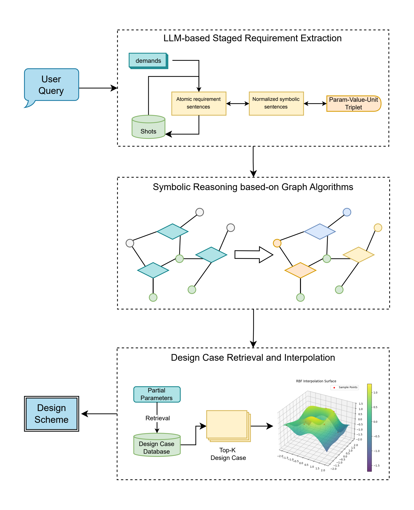
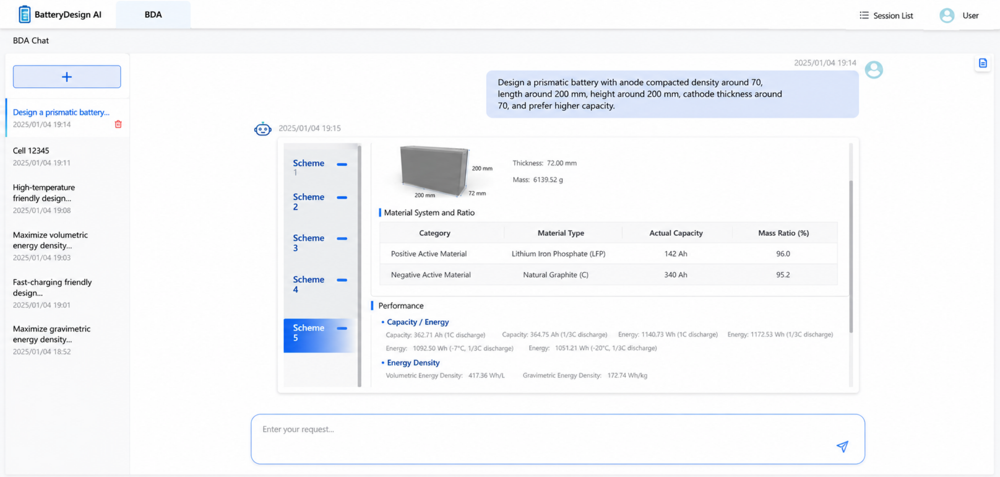

# ChatBDA

### A Traceable Framework for Battery Candidate Design from Natural-Language Design Requirements and Structured Performance Targets

A research preview of a battery design assistant that connects natural-language requirements, symbolic reasoning, and database-supported candidate design.

[Abstract](#abstract) · [System overview](#system-overview) · [Interface](#interface) · [Selected results](#selected-results)

## Abstract

Translating sparse engineering requirements into battery-design candidates requires domain expertise and repeated numerical evaluation. We present a traceable design-assistance framework that combines large language models, symbolic reasoning, and database-supported completion for preliminary battery design. Staged extraction converts natural-language design requirements into canonical parameter triplets. A formula–parameter graph infers dependent quantities and traces conflicts, while retrieval and local inverse design complete candidate designs based on design constraints and structured performance targets. Final requirement checks report deviations for engineering review.

Experiments show that staged extraction achieves an F1 score of 88.41%, exceeding a single-prompt baseline by 15.46 percentage points. Backend ablations demonstrate complementary contributions from target-directed optimization and symbolic consistency. Mean end-to-end wall-clock latency is 18.55 s. Across 20 designs, comparison with pseudo-two-dimensional simulations yields a mean absolute relative error of 13.56%, with closer agreement for capacity and energy than for power. Mixed-query evaluation quantifies requirement agreement, while expert assessment indicates value for preliminary design work. These results support the framework as an upstream tool for producing inspectable candidates and starting points for subsequent simulation, optimization, and engineering refinement.

## System overview

  

1. **Interpret requirements.** Staged language-model calls convert natural-language requests into canonical parameter–value–unit triplets.
2. **Reason over constraints.** A formula–parameter graph infers dependent quantities and traces inconsistencies.
3. **Complete and review candidates.** Retrieval and local inverse design fill missing specifications; final checks report deviations from the requested targets.

## Interface

*Anonymized and translated interface from the manuscript. Candidate configurations and predicted performance remain available for engineering review.*

## Selected results

### Requirement extraction

Triplet-level extraction performance reported in the manuscript (Table 10). Time is the mean extraction time, not end-to-end system latency.

| Method | Precision (%) ↑ | Recall (%) ↑ | F1 (%) ↑ | Time (s) ↓ |
|---|---:|---:|---:|---:|
| Single-prompt baseline | 68.37 | 78.19 | 72.95 | 2.666 |
| **Staged extraction (ChatBDA)** | **83.94** | **93.37** | **88.41** | 8.693 |

Staged extraction improves F1 by **15.46 percentage points**, with additional processing time. Mean end-to-end wall-clock latency is **18.55 s**.

### Validation against P2D simulations

Selected columns from manuscript Table 16: absolute relative error over **20 candidate designs and 140 matched performance values**. Lower is better. `n` counts matched outputs, not independent designs.

| Metric group | ChatBDA mean error (%) ↓ | Nearest-neighbor mean error (%) ↓ | n |
|---|---:|---:|---:|
| Capacity | **7.25** | 8.10 | 40 |
| Energy | **7.19** | 8.04 | 40 |
| Continuous discharge power | **20.15** | 22.95 | 20 |
| Peak discharge power | **22.93** | 25.18 | 40 |
| **Overall** | **13.56** | 15.08 | **140** |

Capacity and energy predictions agree more closely with simulation than power predictions. The framework produces preliminary candidates for downstream simulation, optimization, and engineering refinement.

## Availability

This repository contains the project abstract, selected figures, and reported results. Source code, model artifacts, and underlying datasets are not publicly released at this time.

Figures and results are reproduced from the project manuscript. This preview does not grant an open-source license to the underlying implementation or research materials.
